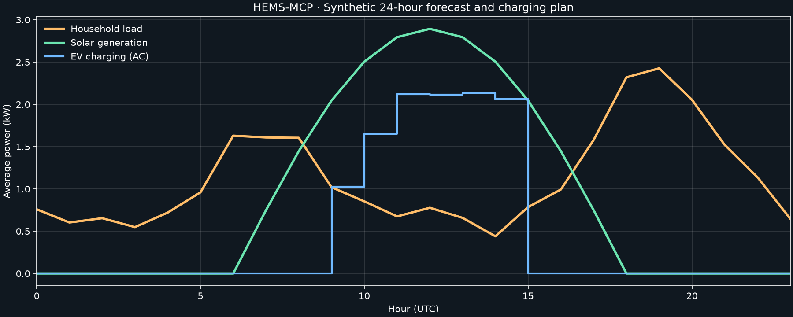
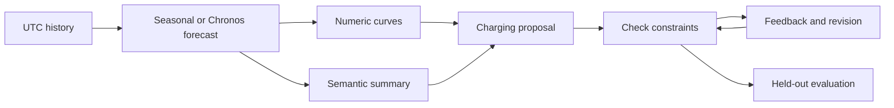

# HEMS-MCP

Forecast household load and solar generation, inspect surplus windows, and explore EV charging plans through MCP.

[](https://github.com/MaheshBhushan/hems-mcp/actions/workflows/tests.yml)

[Quickstart](#quickstart) · [Results](#results) · [Usage](docs/USAGE.md) · [Implementation handoff](docs/IMPLEMENTATION_HANDOFF.md)



*Actual output from the offline demo: 24 hourly slots, seasonal-naive forecasts, and a 10 kWh battery-energy request. The charging curve shows AC power before efficiency losses.*

Household demand and solar production change throughout the day. A charging plan needs both a forecast and numerical checks for available time, charger power, and grid capacity.

HEMS-MCP exposes those calculations as asynchronous MCP tools. It provides a reproducible offline baseline, an optional real Chronos-Bolt model, and an evaluation harness for comparing LLM-only reasoning with numeric forecast curves and semantic summaries. The system explores plans; it does not operate a charger.

## Quickstart

Install [uv](https://docs.astral.sh/uv/), then run:

```sh
git clone https://github.com/MaheshBhushan/hems-mcp.git
cd hems-mcp
uv sync --locked --python 3.12 --group dev
mkdir -p artifacts
uv run hems-mcp demo --days 14 --seed 42 --output-dir artifacts/demo > artifacts/demo-output.json
```

The offline demo needs no API credentials or model download. It writes history, forecasts, surplus summaries, charging schedules, and a rolling-origin evaluation under `artifacts/demo/`. Open `artifacts/demo/evaluation/report.md` for results.

```sh
uv run hems-mcp forecast artifacts/demo/history.csv --backend seasonal --output artifacts/forecast.json
uv run hems-mcp summarize artifacts/forecast.json --output artifacts/summary.json
uv run hems-mcp schedule artifacts/forecast.json --energy-kwh 10 --output artifacts/schedule.json
uv run python -m pytest tests -q
```

Input rows contain timezone-aware `timestamp`, `load_kw`, and `solar_kw`. Each power value is an interval average. Energy is `sum(power_kw) × interval_minutes / 60`. Validation rejects irregular timestamps, negative powers, and nonfinite values.

## Results

The committed [example results](examples/demo-results.json) come from seed 42, 14 days of synthetic hourly data, and three non-overlapping 24-slot evaluation windows. Each origin trains strictly before its held-out window. The table covers 72 predicted slots per target.

| Seasonal-naive target | MAE (kW) | RMSE (kW) |
|---|---:|---:|
| Household load | 0.1434 | 0.1779 |
| Solar generation | 0.2611 | 0.5466 |

The illustrated charging plan delivers 10 kWh to the battery at 90% efficiency. It consumes 11.111 kWh of AC energy and satisfies the forecast grid cap and availability window. Forecast errors can still cause violations against actual demand.

Real `amazon/chronos-bolt-tiny` inference was separately smoke-tested on CPU with an eight-slot horizon and cached model reuse. These baseline errors do not measure Chronos accuracy. Live LLM comparisons have not been run; missing configurations produce skipped conditions and null usage rather than invented measurements. Synthetic results do not establish performance on real households.

## MCP tools

```sh
uv run hems-mcp serve --transport stdio
```

Configure an MCP client to run this command from the cloned project directory. The service exposes:

| Tool | Output |
|---|---|
| `generate_demo_history` | Reproducible synthetic household observations |
| `forecast_energy` | Load and solar curves with backend identity and timing |
| `summarize_energy` | Energy totals, earliest peaks, timed surplus windows, and text |
| `explore_ev_schedule` | Charging power, delivered energy, feasibility, and shortfall |

CPU work runs outside the event loop. The service bounds admission and retains its worker slot after client cancellation until the computation finishes. Stdio carries the MCP protocol.

## Forecast and reasoning loop



The scheduler uses surplus solar first, then lower household net demand. It reports a partial plan and unmet energy for infeasible requests. LLM experiments preserve original proposals, allow one feedback correction, and label deterministic fallbacks separately. [Usage and evaluation details](docs/USAGE.md) explain the three conditions and their comparison limits.

## Optional backends

Chronos uses an optional dependency group and downloads model weights on its first call:

```sh
uv sync --locked --python 3.12 --group dev --extra chronos
uv run --extra chronos hems-mcp forecast artifacts/demo/history.csv --backend chronos --output artifacts/chronos.json
```

Linux PyPI torch packages can include CUDA dependencies. [CPU-only installation instructions](docs/USAGE.md#optional-chronos) avoid those packages. Requested Chronos failures remain errors; the service never silently substitutes the seasonal backend.

[LLM configuration](docs/USAGE.md#configured-llm-experiment) accepts an OpenAI-compatible endpoint and an environment-variable reference for its API key. Configured evaluation can incur provider charges. Provider compute remains unknown; local CPU time, wall latency, and available token usage are recorded separately.

## Scope and development

The current model covers one EV, continuous charging power, constant efficiency, and fixed availability. It excludes tariffs, charger actuation, minimum-current rules, battery charge curves, and uncertainty-aware grid guarantees. The greedy schedule does not establish peak or tariff optimality.

Run `uv run python -m pytest tests -q` and `uv run ruff check src tests` before submitting a change. Tests cover numerical invariants, held-out splits, mocked HTTP feedback, and official-client MCP stdio calls. They make no paid API calls.

Built by [Mahesh Bhushan](https://github.com/MaheshBhushan). Forecasting uses [Amazon Chronos](https://github.com/amazon-science/chronos-forecasting); transport uses the [official MCP Python SDK](https://github.com/modelcontextprotocol/python-sdk). Report reproducible bugs through [GitHub Issues](https://github.com/MaheshBhushan/hems-mcp/issues).
